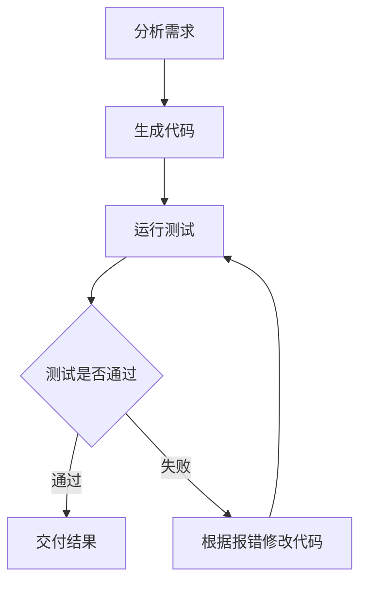

# 第六章学习疑惑与解答

本文件整理阅读[第六章 框架开发实践](<../../hello-agents/docs/chapter6/第六章 框架开发实践.md>)时的疑惑及讨论结果。

## 1. 第六章的框架开发与第五章的低代码平台有什么关系？

对应教材：**6.1 从手动实现到框架开发**、**6.2—6.5 四种框架的实战案例**，以及第五章关于 Coze、Dify、n8n 等低代码平台的内容。

### 疑惑

- 第六章的开发和第五章的低代码平台有什么关系？
- 是不是第六章的开发成品，就是第五章的低代码平台？

### 解答

**（1）第五章和第六章，是用两种不同的方式开发智能体应用。**

第六章的开发成品，通常也是一个应用，而不是第五章那样的低代码平台。

第五章侧重使用现成的平台，通过配置、拖拽等方式构建应用；第六章侧重使用开发框架，通过编写代码构建应用。两章主要是在改变开发方式，并不是把“使用平台”直接推进成“开发这个平台”。

**（2）先区分“智能体应用”“开发框架”“低代码平台”三个概念。**

| 概念 | 作用 | 本书中的例子 |
| ---- | ---- | ------------ |
| 智能体应用 | 完成一个具体任务 | 搜索问答助手、软件开发团队、三国狼人杀 |
| 开发框架 | 提供组件，让程序员通过代码构建应用 | AutoGen、AgentScope、CAMEL、LangGraph |
| 低代码平台 | 提供界面，让用户通过配置、拖拽等方式构建应用 | Coze、Dify、n8n |

其中，应用是面向具体需求的成果；框架和平台则是帮助开发者构建这些成果的工具。

例如，第六章的 LangGraph 案例最终得到的是一个搜索问答助手。它能理解问题、搜索资料并生成答案，但它本身并没有提供一个供其他用户拖拽节点、创建各种智能体应用的通用平台。

**（3）两章的开发路径不同，但都可以得到智能体应用。**

```text
第五章：使用低代码平台 → 配置提示词、工具、工作流 → 智能体应用
第六章：使用开发框架   → 编写角色、工具、流程代码 → 智能体应用
```

这里的两条路径可以实现相似的目标。不能把它们理解成“第五章使用平台，第六章的所有案例都是在开发平台”。

**（4）用同一个需求对比：做一个“先搜索资料，再回答问题”的助手。**

- **第五章的方式**：在平台里添加模型节点、搜索节点，连接流程，配置提示词。
- **第六章的方式**：像 LangGraph 案例那样，编写 `understand`、`search`、`answer` 三个节点，再用代码连接它们。

两种方式都可以形成“理解问题 → 搜索资料 → 生成回答”的处理过程，也都可以把最终答案返回给用户。

**（5）主要区别在于：你在哪一层控制系统。**

低代码平台已经封装了许多细节，你主要通过平台提供的界面、节点和配置项表达需求。

框架开发需要你写更多代码，也让你更方便地定制状态、执行逻辑和异常处理。例如，在第六章的 LangGraph 案例中，你可以直接定义状态中有哪些字段、每个节点更新什么数据，以及搜索失败后如何生成回答。

因此，两者可以实现相似的功能，但开发者接触和控制的系统层次有所不同。

**（6）开发框架也可以用来构建低代码平台的部分底层能力。**

“用框架开发出低代码平台”这条关系确实存在，只是它不是第六章案例的直接目标。

如果希望在框架之上构建一个低代码平台，还需要增加相应的产品和工程能力，例如：

- **可视化编辑器**：让用户通过界面配置节点、连接流程。
- **配置保存**：保存用户创建的应用及其提示词、工具和工作流配置。
- **工作流执行**：把界面上的配置转化为实际运行的步骤。
- **用户管理**：管理使用平台的用户及其应用。
- **部署与监控**：让应用能够对外提供服务，并查看运行情况。

补齐这些能力，才可能形成一个供他人构建应用的平台。仅仅做出一个能搜索、能回答问题的助手，还不等于做出了低代码平台。

而且，低代码平台也可以自己实现执行引擎，并不一定依赖本章介绍的 AutoGen、AgentScope、CAMEL 或 LangGraph。不能因为两者都能构建智能体应用，就认定第五章的平台底层一定使用了第六章的某个框架。

**（7）本书这几章的学习推进，是逐步深入开发工具的内部。**

```text
第五章：体验平台怎么用，通过配置构建应用
                         ↓
第六章：学习用框架写应用，通过代码组织智能体和执行流程
                         ↓
第七章：进一步学习框架本身怎么造
```

第五章帮助理解平台提供了哪些构建能力，第六章让你通过代码掌握应用的组织方式，第七章则进一步研究这些通用能力如何被抽象和实现为框架。


## 2. 本章开发的是什么应用？如何理解四个框架的特点和区别？

对应教材：**6.1.2 主流框架的选型与对比**，以及 **6.2 AutoGen**、**6.3 AgentScope**、**6.4 CAMEL**、**6.5 LangGraph** 的案例；同时联系第一章关于 Workflow 和 Agent 的区别。

### 疑惑

- 6.1.2 中的介绍比较抽象，感觉不到各个框架有什么特点和区别。
- “对话”“消息传递”“角色扮演”“图”分别是什么意思？
- 我们开发的不是智能体应用吗？为什么天气查询小程序的例子看起来像传统程序？
- 狼人杀游戏本身就是智能体应用，还是开发狼人杀的助手才是智能体应用？
- 应当怎样区分应用、应用生成的成果，以及应用具有多少自主决策能力？

### 解答

**（1）先明确四个案例分别在开发什么应用。**

四个框架都在帮助开发者组织智能体或 AI 工作流完成任务。理解它们之前，先明确：我们写出的系统接受什么任务，模型在系统运行时做什么。

| 框架 | 我们开发的应用 | AI 在运行时做什么 |
| ---- | ---------------- | ------------------ |
| AutoGen | 软件开发团队，也就是 AI 开发助手 | 分析需求、编写和审查代码 |
| AgentScope | 多个 AI 玩家参与对局的狼人杀游戏；游戏本身就是多智能体应用 | 发言、推理身份、选择目标、投票 |
| CAMEL | 作家与心理学家协作的写作系统 | 提出写作要求、生成和修改内容 |
| LangGraph | 搜索问答助手 | 理解问题、生成搜索词、综合资料回答 |

还要区分**应用本身**与**应用生成的成果**。AutoGen 案例中，我们编写的是“软件开发团队”系统，比特币价格展示应用是这个团队要完成的任务成果；就像 AI 写作助手可以生成一篇文章，文章本身并不是智能体。

狼人杀案例的开发对象则是游戏：我们写好游戏程序，程序运行后由 AI 玩家参与对局。这里没有另外搭建一个“帮我们编写狼人杀代码的助手”。

6.1.2 用“对话”“消息传递”“角色扮演”“图”概括四个框架的侧重点。这些能力有重叠，不能理解成四种能力互斥的分类。下面直接用教材的四个案例，分别看应用怎样运行、模型和框架各负责什么。

**（2）AutoGen：用有分工、有发言规则的项目组完成软件开发任务。**

**应用怎样运行：** 用户把开发需求交给这个系统，例如“开发一个比特币价格展示应用”。产品经理先分析需求，工程师根据需求生成代码，代码审查员给出检查意见，用户代理提供人与团队交互的入口。

一次协作可以像下面这样展开，这里是帮助理解的示意对话：

> 产品经理：“需要显示当前价格、24 小时变化，并提供刷新功能。”  
> 工程师：“我根据这些需求写出了代码……”  
> 代码审查员：“这里需要补充接口请求失败时的处理。”  
> 再次轮到工程师时：“我根据审查意见修改了代码……”

**模型负责什么：** 具体的需求分析、代码和审查意见，是模型在运行时根据当前任务生成的。我们提前编写的是角色、规则和连接方式，并没有提前写好所有任务的答案。

| 运行中的工作 | 由谁完成 |
| ------------ | -------- |
| 把用户需求分析成具体功能 | 扮演产品经理的模型 |
| 根据需求生成程序代码 | 扮演工程师的模型 |
| 阅读生成的代码，发现问题并给出建议 | 扮演审查员的模型 |
| 把消息交给其他角色、安排发言、检查是否结束 | 框架与我们编写的控制代码 |

**框架负责什么：** AutoGen 组织这些角色之间的对话，让成员交换结果，并按照设定的规则推进。开发者主要设计有哪些成员、每个人负责什么、轮到谁发言、什么时候结束。

本章采用的 `RoundRobinGroupChat` 按名单顺序轮流发言。即使某个智能体说“请程序员修改”，真正的发言顺序仍由群聊规则控制。若要真正运行生成的代码、执行测试，还需要接入相应工具；角色描述中的“测试”不会自动变成代码执行能力。

**案例突出什么特点：** 把任务拆给不同角色，通过对话交换方案和反馈，可以把它理解成“组织一个项目组，让成员接力完成任务”。

补充参考：[AutoGen 官方团队说明](https://microsoft.github.io/autogen/stable/user-guide/agentchat-user-guide/tutorial/teams.html)。

**（3）AgentScope：组织 AI 玩家之间的信息共享和行动，让狼人杀游戏运行起来。**

**应用怎样运行：** 本章 6.3.2 的“三国狼人杀”是一个由多个 AI 玩家参与对局的游戏，**这个游戏本身就是多智能体应用**。AI 的任务是在局中玩游戏，并不是替我们开发游戏代码。

我们写好分配身份、推进昼夜、统计投票和判定胜负的程序。启动游戏后，玩家根据自己的身份和收到的信息讨论、选择目标、使用角色能力并投票。例如，狼人夜间协商目标，白天各玩家根据发言判断谁更可疑。

**模型负责什么：** 每个玩家都是一个连接大模型的 `ReActAgent`。模型根据角色和可见信息，生成发言、推理与行动选择，例如“我怀疑谁”“为什么投他”“今晚查验谁”。这些选择是在游戏运行时生成的，并不是我们提前编好的完整剧本。

**框架负责什么：** AgentScope 提供玩家组件以及消息共享、顺序或并行调用、结构化响应等能力。用一轮游戏来看：

- **夜晚讨论**：用 `MsgHub` 建立只包含狼人的消息组，让狼人的发言在队友之间共享。
- **白天讨论**：换成所有存活玩家的消息组，用 `sequential_pipeline` 组织玩家依次发言，让组内玩家收到彼此的发言。
- **投票**：关闭自动广播，用 `fanout_pipeline` 向各玩家请求选择，通过结构化输出取得明确的投票对象，再由游戏代码统计结果。

三部分的职责需要分清：

| 部分 | 职责 |
| ---- | ---- |
| 我们编写的游戏控制代码 | 分配身份、推进昼夜、统计投票、更新存活名单、判断胜负 |
| 大模型驱动的 AI 玩家 | 根据角色和可见信息，生成发言、推理和行动选择 |
| AgentScope | 提供玩家组件、消息共享、顺序或并行调用，以及结构化响应等能力 |

**案例突出什么特点：** 开发者需要考虑“信息发给谁、哪些任务顺序执行、哪些任务并行执行、结果怎样汇总”。这里尤其要分清**“谁收到消息”与“接下来谁行动”**：消息中心处理信息共享，pipeline 和游戏控制代码组织执行，游戏控制代码仍然安排夜晚、白天、投票和胜负判断。

教材说它重视“工程化”，可以先理解为：提供一套可组合的组件，把多智能体之间复杂的协作关系组织起来。其他框架也能传消息，只是本章从这个角度突出 AgentScope。

配套实现：[main_cn.py](../../hello-agents/code/chapter6/AgentScopeDemo/main_cn.py)。补充参考：[AgentScope 官方 Pipeline 说明](https://doc.agentscope.io/tutorial/task_pipeline.html)。

**（4）CAMEL：让需求方与专家结对，通过对话逐步完成写作任务。**

**应用怎样运行：** 本章让“作家”和“心理学家”合作创作关于拖延症心理学的电子书。我们开发的是组织两位 AI 协作的写作系统，电子书内容是它们要产出的成果。

用户先给出总体任务，两位 AI 再逐步交流。例如：

> 作家：“请先为引言提供一段通俗的说明，让读者理解什么是拖延。”  
> 心理学家：“可以，下面是对这个现象的解释……”  
> 作家：“请增加一个生活案例，并补充实用建议。”  
> 心理学家：“下面是补充内容……”

这段对话用于说明分工，不是预先写死的完整创作流程。

**模型负责什么：** 作家根据目标和已收到的内容提出章节、表达和修改要求，心理学家提供专业内容并回应这些要求。真人给出总体任务后，AI 需求方在对话中不断提出下一步要求，AI 执行方逐步回应。

这里的“AI User”也是智能体，代表需求方或指导方，并不是坐在电脑前持续输入要求的真人。本章中，作家承担这个角色，心理学家承担 AI Assistant 的角色。

**框架负责什么：** CAMEL 的 `RolePlaying` 封装了这种角色与交互设定，让开发者围绕共同任务安排互补角色，并通过对话循环推进协作。交互规则和停止条件仍需由程序设置。

**案例突出什么特点：** 可以把它理解成“安排一对互补的角色，让需求方带着执行方逐步推进”。它与 AutoGen 确实很接近，区别可以这样体会：

> 本章的 AutoGen 更像“组建一个项目组，安排成员如何接力”。  
> 本章的 CAMEL 更像“安排一对互补的角色，让需求方带着执行方逐步推进”。

不要把区别记成“AutoGen 只能多人，CAMEL 只能两人”。这里比较的是本章采用的组织方式；它们都需要程序设置交互规则和停止条件。

补充参考：[CAMEL 官方角色协作说明](https://github.com/camel-ai/camel/wiki/Creating-Your-First-Agent-Society)。

**（5）LangGraph：用状态、节点和边组织搜索问答流程。**

**应用怎样运行：** 用户提出一个需要查资料的问题，助手先理解问题并生成搜索词，再调用搜索服务，最后综合资料生成回答。本章的实际流程是：

```text
用户提问 → 理解问题 → 搜索资料 → 生成回答 → 返回答案
```

这里开发的是直接为用户提供回答的搜索助手。

**模型负责什么：** 理解用户意图、生成搜索词，以及根据搜索结果组织回答。实际搜索由代码调用搜索服务完成；不是每一步都需要交给模型。

**框架负责什么：** LangGraph 将处理步骤组织为节点，用边连接执行顺序，并管理贯穿流程的状态。

| 概念 | 在本章搜索助手中是什么意思 |
| ---- | -------------------------- |
| 节点 Node | 一个处理步骤，例如理解、搜索、回答 |
| 边 Edge | 步骤之间的连接，例如理解后进入搜索，搜索后进入回答 |
| 状态 State | 各步骤共享和更新的数据，例如用户需求、搜索词、搜索结果、最终答案和当前阶段 |

**节点不必对应一个智能体。** 它可以调用模型、调用工具，也可以只是一个普通函数。开发者主要考虑：任务有哪些步骤、每一步需要什么数据、什么条件下进入下一步、失败后回到哪里。

**案例突出什么特点：** 可以把它理解成“一张可以执行的流程图”。模型仍然可以发挥判断能力，但必要步骤与跳转规则由开发者明确表达。

本章先用“理解 → 搜索 → 回答”这条线性流程帮助读者掌握基本概念；搜索失败时的处理写在回答节点内部。支持分支和循环是框架提供的能力，不代表这个入门案例已经加入了反思、重试或自主规划。

补充参考：[LangGraph 官方 Graph API 说明](https://docs.langchain.com/oss/python/langgraph/graph-api)。

**（6）看完四个案例，再比较它们各自强调什么。**

| 框架 | 先用什么形象理解 | 开发时重点思考 |
| ---- | ---------------- | -------------- |
| AutoGen | 有分工和发言规则的项目组 | 谁负责什么？成员怎样通过对话接力？ |
| AgentScope | 团队的通信和协作设施 | 谁收到哪些信息？怎样组织顺序、并行和结果汇总？ |
| CAMEL | 需求方与专家结对工作 | 如何设定互补角色，让双方逐步提出要求、解决问题？ |
| LangGraph | 可以执行的流程图 | 状态怎么变化？下一步走哪里？什么时候回退或结束？ |

这些问题代表本章的观察角度，各框架的能力有重叠。阅读代码时，可以反复问自己：**“这段代码是在定义角色、传递信息，还是决定下一步？”** 这样就能看出，框架具体替你承担了哪些工作。

**（7）补充对照：把同一个天气程序开发任务交给 AI，四种组织方式会是什么样？**

前面已经用教材案例明确了应用类型。下面保留天气程序的例子，用来横向比较四种组织方式。

共同任务是：

> 让 AI 帮我们开发一个天气查询小程序：输入城市，显示天气，并处理查询失败的情况。

这个例子必须分清两层：**我们使用框架开发的是 AI 开发助手，天气查询程序是这个助手接受任务后生成的成果。** 天气查询程序本身完全可以是传统软件。

```text
我们使用框架开发的：
AI 开发助手
    │
    │ 用户交给它任务：“帮我开发天气查询程序”
    │ 它分析需求、生成代码、审查代码
    ↓
它生成的成果：
天气查询程序
```

如果只关注最后的天气程序，就容易把“我们开发的系统”与“这个系统生成的东西”混在一起。下面四种写法都是在说明 AI 开发助手如何组织工作。

**用 AutoGen 的团队对话方式组织：**

创建产品经理、程序员、代码审查员，分别给出职责，并安排它们交换信息：

> 产品经理：“需要城市输入框、查询按钮、天气显示区域，还要考虑查不到城市的情况。”  
> 程序员：“我根据这些需求写出了代码……”  
> 审查员：“这里没有处理网络超时，请补充。”  
> 再次轮到程序员时：“我根据审查意见修改了代码……”

每个智能体根据自己的职责和收到的信息做出回应。开发者组织成员与发言规则，模型生成具体方案和反馈；在轮询模式下，仍然要等轮到对应成员时才由它发言。

**用 AgentScope 的协作组件组织：**

当协作方式复杂一些，会遇到以下问题：

- 产品经理的需求，要怎样发给所有相关成员？
- 程序员写完代码后，能否让两个审查员同时检查，一个看功能，一个看错误处理？
- 怎样收集两人的结果，再交给程序员修改？
- 有些信息只应该发给某个小组，怎样控制？

`MsgHub` 可以让组内成员收到彼此的消息；pipeline 可以组织顺序执行或把同一份输入分发给多个智能体。这个例子突出的是信息分发、顺序与并行执行、结果汇总。

**用 CAMEL 的角色结对方式组织：**

设定两个互补角色：

- 一个 AI 扮演产品设计师，负责提出具体要求、推动任务。
- 一个 AI 扮演程序员，负责针对要求给出实现方案。

给它们共同目标，让它们逐步对话：

> 产品设计师：“先做输入城市和显示天气的基本功能。”  
> 程序员：“可以，下面是基本实现。”  
> 产品设计师：“现在增加查询失败时的提示。”  
> 程序员：“我增加了异常处理。”  
> 产品设计师：“再检查一下用户输入为空时会怎样。”

这里真人提供总体任务，AI 产品设计师作为需求方逐步提出要求，AI 程序员作为执行方回应，与本章作家和心理学家的分工相对应。

**用 LangGraph 的流程图方式组织：**

可以规定 AI 开发助手按照下面的流程运行：



| 概念 | 在这个例子中是什么意思 |
| ---- | ---------------------- |
| 节点 Node | 一个具体步骤，例如生成代码、运行测试 |
| 边 Edge | 步骤之间的连接，例如测试失败后进入修改步骤 |
| 状态 State | 随任务保存和更新的数据，例如需求、当前代码、报错、修改次数 |

“生成代码”节点可以调用模型，“运行测试”节点可以调用测试工具，“检查修改次数”也可以只是普通程序。节点不必对应一个智能体。

开发者可以规定“测试必须执行”，还可以增加“最多修改三次”的限制。上图展示了测试失败后回到修改步骤的基本循环，并未画出次数上限分支。真正执行测试需要接入测试工具。

这个代码生成、测试与修改循环，是帮助理解 LangGraph 组织方式的扩展示例；本章实际实现的仍是前面介绍的线性搜索问答流程。

**（8）统一辨析：应用由代码实现、流程固定，与其中具有智能体能力并不矛盾。**

智能体应用本身也需要用 Python 等语言编写。不能因为看见普通程序代码，就认为它只能按固定规则处理数据。应当观察系统运行时，哪些内容由开发者预先确定，哪些工作交给模型根据任务完成。

同时，**“使用了大模型”和“具有自主决策能力的智能体”还需要进一步区分。** 换成一个直接供用户使用的“天气与出行助手”，可以看到三个层次：

| 类型 | 用户提出问题后，系统怎样工作 |
| ---- | -------------------------- |
| 传统程序 | 用户输入城市，程序调用固定的天气接口，再按固定格式展示结果。 |
| 包含大模型的工作流 | 程序规定“查天气 → 让模型生成出行建议”，每次都按这个流程执行。 |
| 具有自主决策能力的智能体 | 模型根据用户目标和已有信息，决定是否追问地点、查询哪些信息、调用什么工具，以及得到结果后是否需要调整方案。 |

这三种应用都可以用代码实现，也都可能涉及天气查询。差别需要从运行时的任务推进方式来观察。

例如，用户说：

> “帮我安排周六的活动，我想多在户外走走，但不想淋雨。”

一个具有自主决策能力的助手可能这样推进：

```text
发现不知道用户在哪个城市 → 先询问城市
拿到城市 → 查询周六天气
发现下午有雨 → 考虑上午户外、下午室内
发现还缺合适的室内地点 → 再搜索相关信息
信息足够 → 给出安排
```

**这里体现智能体能力的地方，是模型会根据当前情况选择和调整行动。** 如果这些步骤和所有分支都是开发者提前规定好的，那么它更接近一个包含大模型的工作流。因此，不能只看最终展示出来的执行顺序，还要看这个顺序是开发者预先规定的，还是模型根据任务与中间结果选择出来的。

回到狼人杀，**游戏规则固定，与玩家自主决策可以同时存在**：昼夜顺序由程序规定，玩家在允许的阶段内决定说什么、投谁、查谁。就像棋规固定，但棋手每一步怎么走并没有预先写好。玩家具有策略层面的自主性，并不要求它能够改变游戏规则或自行决定何时进入白天。

智能体框架既能组织自主行动的智能体，也能搭建流程比较固定的 AI 应用。使用了智能体框架，不代表每个案例都充分展示了自主规划能力。本章 LangGraph 的“理解 → 搜索 → 回答”案例主要是在演示固定工作流，帮助读者先掌握状态、节点和边，再进一步理解分支、循环和更复杂的决策过程。

看后面的案例时，可以始终把两个问题分开判断：

1. **我们正在开发什么应用？** 看它接收什么任务、向用户提供什么服务。
2. **它有多少智能体自主性？** 看运行时哪些行动由模型决定，哪些步骤由程序预先规定。

先明确用户使用的应用是什么，再观察它自身的运行过程，就能避免把应用生成的文章、代码或普通软件当成应用本身，也能识别狼人杀这种“智能体直接在游戏中行动”的情况。
